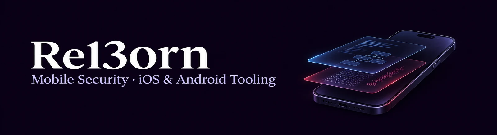

我做移动应用安全测试，也写 iOS 和 Android 分析工具。

### 移动安全工具

- [**iAppVM**](https://github.com/Re13orn/iAppVM) · 在非越狱设备上测试 iOS 应用的工作台。
- [**mobile-app-testing-mcp**](https://github.com/Re13orn/mobile-app-testing-mcp) · 通过 MCP 使用 ADB、aapt 和 JADX，做 Android 应用分析。
- [**scamAppScan**](https://github.com/Re13orn/scamAppScan) · 用于检测恶意 APK。

> 愿你眼中总有光明 :)
